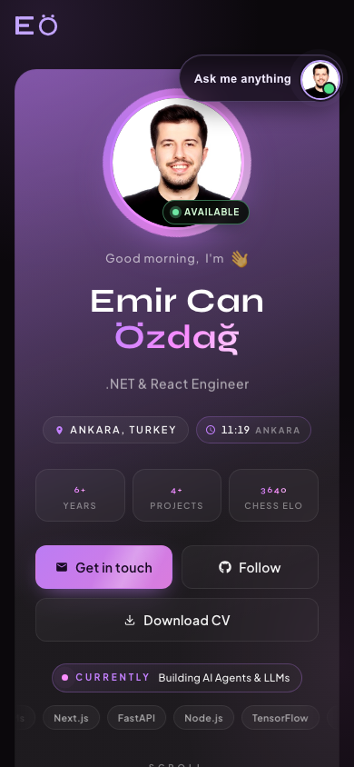
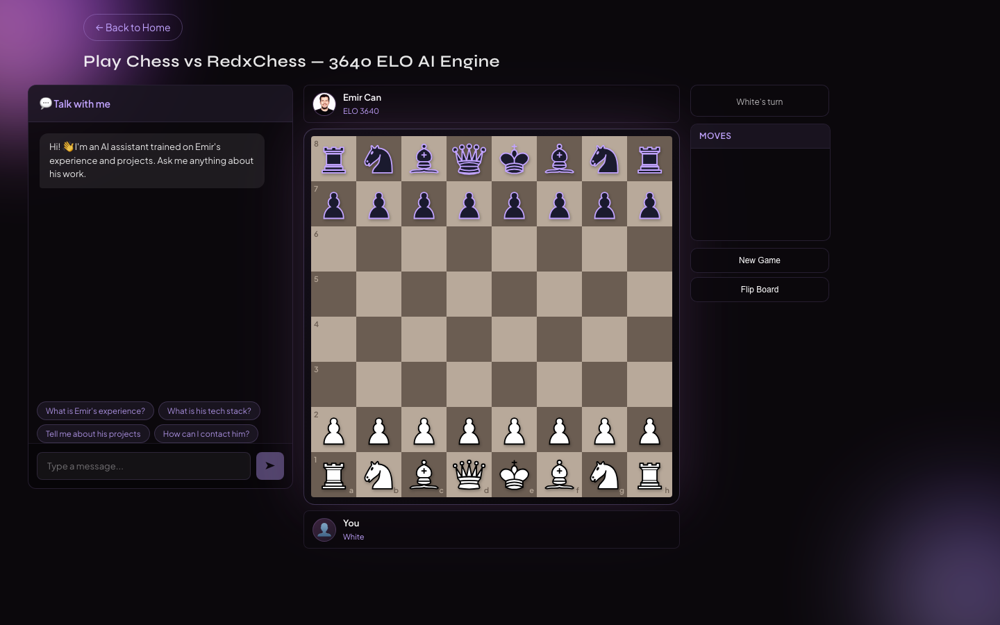

# emircanozdag.com: Personal Portfolio

My personal site: a 3D interactive portfolio with an AI chat assistant that answers questions about my experience, a playable chess page, and a password-protected admin panel for managing the assistant.

**Live:** [emircanozdag.com](https://emircanozdag.com)

<p align="center">
  
  &nbsp;
  
</p>

> **Built on an open-source template.** The 3D character scene, GSAP animations, base layout and the RedoxChess engine come from [Redoyanul Haque's portfolio](https://github.com/red1-for-hek) (MIT). Everything listed under [What I built](#what-i-built) is my own work on top of it.

## What I built

**Admin panel and backend** (`api/`, `src/admin/`)
- Serverless API on Vercel Functions, with Upstash Redis for settings, FAQ, chat logs and analytics
- Admin login using JWT (`jose`) in an HttpOnly cookie, with brute-force rate limiting on login attempts
- Panels to edit the assistant's system prompt, model, FAQ and maintenance mode, plus chat log review and daily usage analytics

**AI chat assistant** (`api/chat.js`, `src/components/chat/`)
- The system prompt is built on the server from Redis, so the client never controls it
- Per-IP rate limiting (20 requests/min), plus caps on message count and message length
- Mobile floating chat: persists across visits via localStorage, expands to a full-screen sheet pinned to the visual viewport while typing
- Optional transcript logging by email via Resend

**Performance**
- Desktop and mobile component trees load lazily, which shrank the main container chunk from 54 KB to 11 KB
- Custom cursor driven by `gsap.quickSetter` instead of creating a tween every frame; rAF-throttled resize handling
- Redis calls batched with `MGET` and pipelines
- Immutable cache headers for hashed assets; non-blocking font loading and lazy images

**Quality and observability**
- Playwright e2e tests for desktop and mobile, run against the production build. They cover render errors, the mobile bundle split, cache-busting, the chess page and a load budget.
- Sentry error and performance monitoring (enabled via `VITE_SENTRY_DSN`)
- Vercel Analytics and Speed Insights

**SEO**
- Per-page meta tags and JSON-LD structured data (`schema.org` Person and WebSite), sitemap, robots.txt
- Security headers (`X-Frame-Options`, `nosniff`, `Referrer-Policy`); `/admin` excluded from indexing

## Tech stack

React 18 · TypeScript · Vite · Three.js · GSAP · React Router · Vercel Functions · Upstash Redis · Groq (LLM) · Playwright · Sentry

## Running locally

```bash
npm install
cp .env.example .env    # fill in GROQ_API_KEY and the Upstash keys
npm run dev             # http://localhost:5173
```

```bash
npm run build && npm run test:e2e   # production build + Playwright tests
```

To run the `/api` functions locally, use `vercel dev`. Everything in `.env.example` except `GROQ_API_KEY` and the Upstash keys is optional.

## Project structure

```
api/            Vercel serverless functions (chat, admin, chat logging)
  _lib/         Redis store and JWT auth helpers
src/
  components/   Site sections, 3D character, chat, chess
  admin/        Admin panel UI
  pages/        Projects, chess and admin routes
  seo/          Meta tags and JSON-LD
  monitoring/   Sentry setup
e2e/            Playwright tests
```

## License

MIT. See [LICENSE](LICENSE); the original template copyright is kept there as the license requires.
